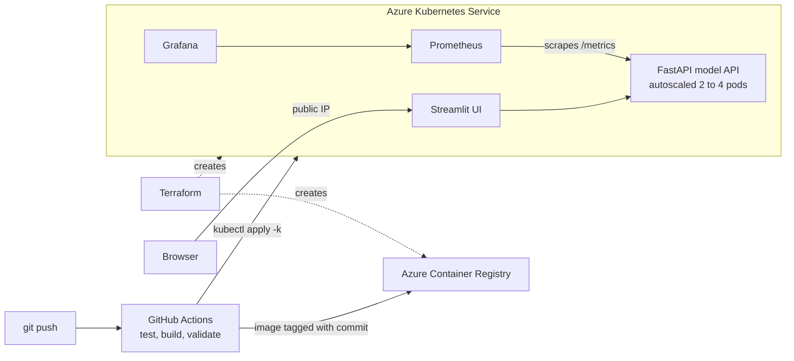

# MLOps tumor classifier

An end-to-end MLOps project: a scikit-learn classifier on the Wisconsin Diagnostic Breast Cancer
dataset, served by FastAPI, with a Streamlit UI, and shipped to Azure Kubernetes Service through
GitHub Actions, with Terraform infrastructure and Prometheus and Grafana monitoring.

> Demo project. It is not a medical device and must not be used for diagnosis.



## What is where

| Requirement | Where | How it works |
|---|---|---|
| GitHub versioning | git history | Every image tag and model version is the commit's short SHA, visible in the UI, `/model` and Grafana |
| CI/CD | [.github/workflows](.github/workflows) | `ci.yml` runs lint, tests, image build and smoke test, and manifest and Terraform validation. `cd.yml` then builds, pushes and deploys `main`, rolling back if the rollout fails |
| Docker | [Dockerfile](Dockerfile), [docker-compose.yml](docker-compose.yml) | One image for API and UI. The model trains during the build, and a model below the quality gate fails the build |
| Kubernetes | [k8s](k8s) | Kustomize manifests with probes, resource limits, an autoscaler and non-root containers |
| Terraform | [terraform](terraform) | Resource group, container registry, AKS and a passwordless GitHub identity |
| Monitoring | [k8s/monitoring](k8s/monitoring) | Prometheus scrapes the API and evaluates alert rules. Grafana comes with the dashboard preinstalled |
| Streamlit and Azure | [streamlit_app.py](streamlit_app.py) | Public on AKS through a load balancer. Also runs unchanged on Streamlit Community Cloud |

## Run locally

```bash
make install
make test
make train
make api    # http://localhost:8000/docs
make ui     # http://localhost:8501 (scores in-process unless API_URL is set)
```

Full stack in Docker:

```bash
make up
```

| Service | URL |
|---|---|
| Streamlit | http://localhost:8501 |
| API docs | http://localhost:8000/docs |
| Prometheus | http://localhost:9090 |
| Grafana | http://localhost:3000 (`admin` / `admin`, or set `GRAFANA_ADMIN_PASSWORD`) |

Local Kubernetes with [kind](https://kind.sigs.k8s.io):

```bash
make kind-up
kubectl -n mlops port-forward svc/ui 8501:80
make kind-down
```

## Deploy to Azure

AKS costs money for as long as it runs, mainly the node VM, public IP and load balancer. Check the
[Azure pricing calculator](https://azure.microsoft.com/pricing/calculator/) for your region, and
run `terraform destroy` when you are done.

**1. Create the infrastructure**

```bash
az login
cd terraform
cp terraform.tfvars.example terraform.tfvars   # fill in your subscription and repository
terraform init
terraform apply
terraform output github_variables
```

State is kept in a local file, which is gitignored because it can contain secrets. Add an
[`azurerm` backend](https://developer.hashicorp.com/terraform/language/backend/azurerm) if more than
one person or machine will run Terraform.

**2. Connect GitHub to Azure**

Set each value from `github_variables` as a repository variable, and choose a Grafana password:

```bash
gh variable set AZURE_CLIENT_ID --body "<value>"   # repeat for each output
gh secret set GRAFANA_ADMIN_PASSWORD
```

**3. Deploy**

The deploy job stays skipped until `AZURE_CLIENT_ID` exists. After that every push to `main` deploys.
To deploy right away:

```bash
gh workflow run CD
```

**4. Open it**

```bash
az aks get-credentials --resource-group mlops-rg --name mlops-aks
kubectl -n mlops get svc ui                                  # EXTERNAL-IP is the public Streamlit URL
kubectl -n mlops port-forward svc/grafana 3000:3000          # Grafana stays private
kubectl -n mlops port-forward svc/prometheus 9090:9090       # Prometheus stays private
```

The Streamlit app is public and has no login. It only exposes the demo model.

### Streamlit Community Cloud (optional)

For a free hosted UI without Azure, point [Streamlit Community Cloud](https://share.streamlit.io) at
this repository with `streamlit_app.py` as the entry point and Python 3.12. It trains the model on
first start and scores in-process, so this route has no API metrics.

## Monitoring

The API exports these metrics at `/metrics`:

| Metric | Meaning |
|---|---|
| `mlapi_requests_total` | Requests by method, route and status |
| `mlapi_request_duration_seconds` | Latency by route |
| `mlapi_predictions_total` | Predictions by class |
| `mlapi_prediction_confidence` | Probability of the predicted class |
| `mlapi_out_of_range_predictions_total` | Predictions with a feature outside the training range |
| `mlapi_model_info`, `mlapi_model_test_roc_auc` | Loaded model version, type and test score |

[alerts.yml](k8s/monitoring/alerts.yml) defines `ApiDown`, `HighErrorRate`, `HighPredictLatency` and
`InputDrift`. They show on the Prometheus Alerts page. Sending notifications would need Alertmanager,
which is not included.

Edit the dashboard in [scripts/build_dashboard.py](scripts/build_dashboard.py), then run it to
regenerate the JSON. CI fails if the two differ.

## API example

```bash
python - <<'EOF'
import requests
base = "http://localhost:8000"
stats = requests.get(f"{base}/model").json()["feature_stats"]
features = {name: s["median_malignant"] for name, s in stats.items()}
print(requests.post(f"{base}/predict", json={"features": features}).json())
EOF
```
